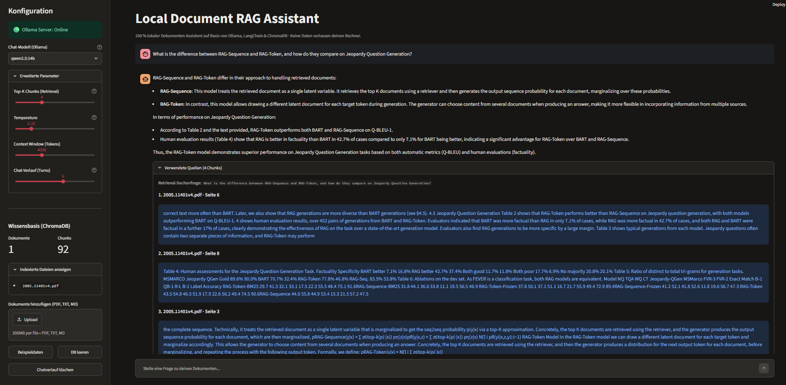
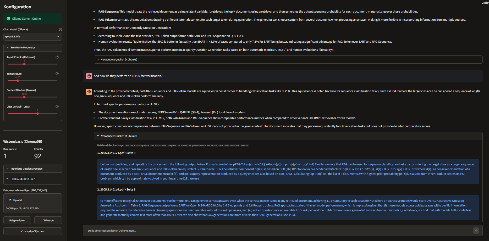
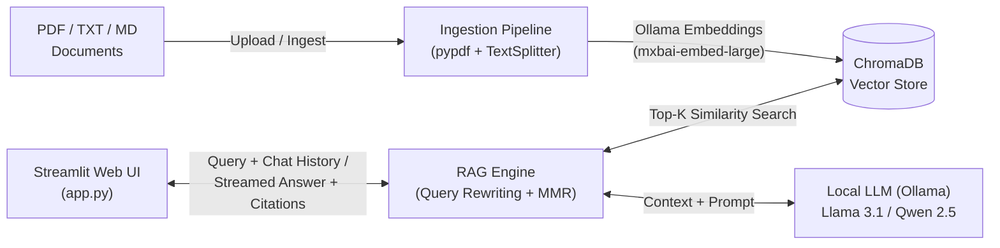

# Local Document RAG Assistant

A 100% local, privacy-first **Retrieval-Augmented Generation (RAG)** assistant built with **Ollama**, **LangChain**, **ChromaDB**, and **Streamlit**. Query PDF, TXT, and Markdown documents completely offline—no API keys required and no data ever leaves your machine.


*Main chat interface showing a cross-section query against the RAG paper (`qwen2.5:14b`), live ChromaDB index metrics, and expandable source citations with page numbers.*

---

## Key Features

- **100% Local & Private Execution:** Powered by local LLMs and embedding models via [Ollama](https://ollama.com/) and a persistent local [ChromaDB](https://www.trychroma.com/) vector store.
- **Interactive Document Management:** Upload `.pdf`, `.txt`, and `.md` files directly via the Streamlit sidebar, ingest sample documents, or reset the vector database with a single click.
- **Idempotent Ingestion Pipeline:** Automatically deduplicates re-indexed files by source filename and splits documents using `RecursiveCharacterTextSplitter` with configurable overlap.
- **Conversation-Aware Retrieval:** Rewrites follow-up questions into standalone search queries using chat history, paired with **Maximal Marginal Relevance (MMR)** retrieval for diverse context passages.
- **Full Source Transparency:** Displays exact source filenames, page numbers, rewritten search queries, and retrieved text chunks under every response.
- **Real-Time Token Streaming & Reasoning Support:** Streams answers token-by-token and cleanly separates `<think>` reasoning blocks when using models like `DeepSeek-R1`.


*Follow-up question handling with automatic query rewriting (`Retrieval-Suchanfrage`), expanded retrieval parameters, and indexed file inspection.*

---

## Architecture



---

## Project Structure

```text
local-rag-assistant/
├── app.py                  # Streamlit UI, live file upload, model selection & chat interface
├── src/
│   ├── __init__.py
│   ├── config.py           # Central configuration (paths, chunk sizes, default parameters)
│   ├── ingestion.py        # Document parsing, chunking, deduplication & ChromaDB management
│   └── rag_engine.py       # History-aware query rewriting, MMR retriever & streaming RAG chain
├── data/
│   └── sample_docs/        # Sample documents (e.g., Lewis et al. RAG Paper, arXiv:2005.11401)
├── assets/                 # UI screenshots for documentation
│   ├── demo_overview.png
│   └── demo_followup.png
├── requirements.txt        # Python dependencies
├── .gitignore              # Excludes local vector DB, uploaded files & virtual environments
└── README.md
```

---

## Getting Started

### 1. Prerequisites & Model Selection

- **Python 3.10+**
- **[Ollama](https://ollama.com/download)** installed and running locally

Pull the required embedding model and at least one chat model:

```bash
ollama pull mxbai-embed-large
ollama pull qwen2.5:14b
```

#### Recommended Models by Hardware Tier

Depending on your available GPU VRAM / system RAM, you can select between lightweight and high-accuracy models directly in the UI dropdown:

| Tier | Chat Model (`ollama pull ...`) | Approx. VRAM | Best For |
| :--- | :--- | :--- | :--- |
| **High Accuracy (Recommended)** | `qwen2.5:14b` or `llama3.1:8b` | 8 – 12 GB | Best faithfulness, complex tables, and cross-lingual QA (e.g., querying English PDFs in German) |
| **Balanced** | `qwen2.5:7b` | ~6 GB | Fast responses with strong instruction following |
| **Lightweight (Low Resource)** | `llama3.2:3b` or `qwen2.5:3b` | ~3 GB | Laptops or systems with limited disk space / VRAM |
| **Reasoning (Optional)** | `deepseek-r1:8b` | ~6 GB | Multi-step reasoning across chunks (with collapsible `<think>` output) |

**Embedding Models** *(configurable in `src/config.py`)*:
- `mxbai-embed-large` *(default, ~670 MB)* — High-precision dense retrieval
- `bge-m3` *(~1.2 GB)* — Ideal for multilingual document collections
- `nomic-embed-text` *(~275 MB)* — Ultra-lightweight alternative for constrained hardware

### 2. Installation

Clone the repository and set up a virtual environment:

```bash
git clone https://github.com/xdennis090/local-rag-assistant.git
cd local-rag-assistant

python -m venv .venv
# Windows:
.venv\Scripts\activate
# Linux / macOS:
source .venv/bin/activate

pip install -r requirements.txt
```

### 3. Run the Application

```bash
streamlit run app.py
```

Open your browser at `http://localhost:8501`, click **"Beispieldaten"** (or upload your own documents) in the sidebar, and start asking questions.

---

## Tech Stack

- **Frontend:** Streamlit
- **Orchestration:** LangChain (`langchain-core`, `langchain-ollama`, `langchain-chroma`, `langchain-text-splitters`)
- **Vector Database:** ChromaDB (local persistent storage)
- **LLM & Embeddings Runtime:** Ollama (`mxbai-embed-large`, `Qwen 2.5`, `Llama 3.1 / 3.2`, `DeepSeek-R1`)
- **Document Parsing:** `pypdf`